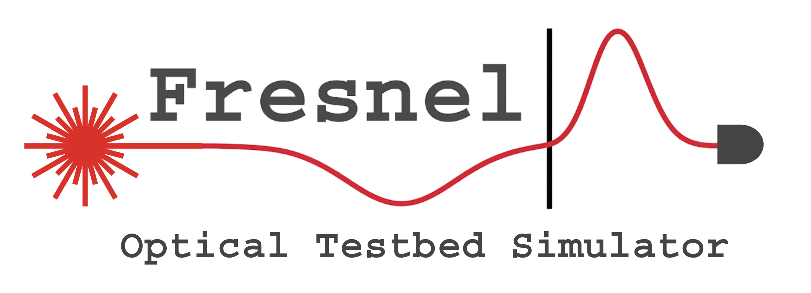
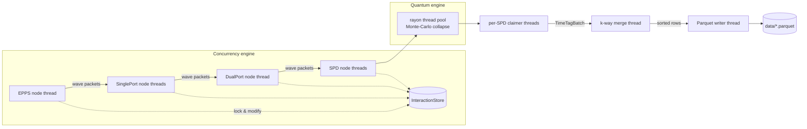
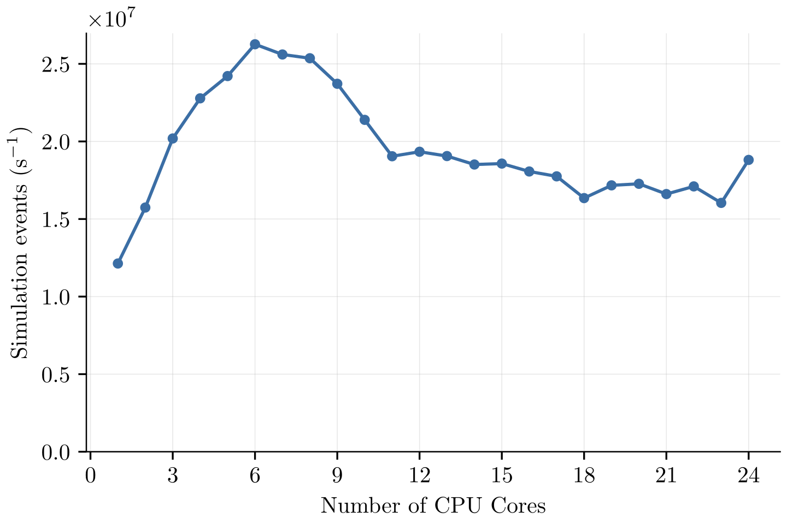
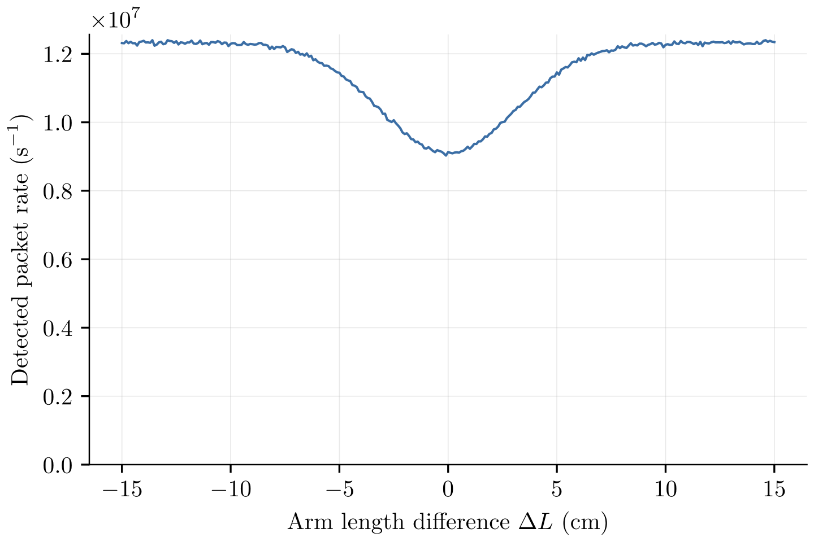
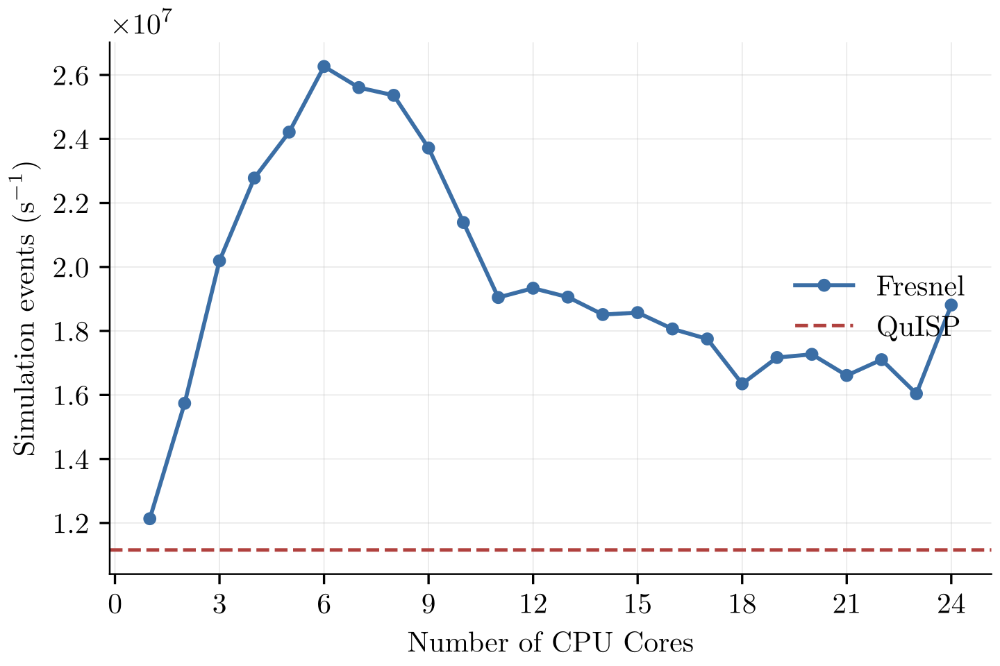

<p align="center">
  
</p>

# Fresnel

Fresnel is a high-throughput simulator for photonic quantum-network testbeds.
It started as a highly experimental fork of Q-stream, a discrete-event photonic
quantum interference simulator, and focuses on throughput and parallel
computing on a concurrent-lock architecture.

Fresnel simulates light at the wave-packet level and writes detector time tags
to Parquet files. The output has the format, the fidelity, and the rate of a
physical time tagger. A real testbed detects on the order of 10⁷ photons per
second. Because the data format is the same, you can test production network
software against simulated data without changes to that software.

**Highlights** (AMD Ryzen AI 9 HX PRO 375, 24 logical cores):

- Peak event rate: 2.6 × 10⁷ simulation events per second (6 cores).
  Single-core rate: 1.2 × 10⁷ events per second.
- Detected packet rate in the Hong–Ou–Mandel (HOM) topology: up to
  1.24 × 10⁷ per second.
- Memory footprint: about 6 MB. Fresnel fits into a larger system-software
  pipeline.
- Correctness: a HOM arm-length sweep shows the expected interference dip
  (visibility ≈ 27 % with the default detector model, spread ≈ 5 cm). This
  agrees with the experimental result.

---

## Table of contents

1. [Quick start](#quick-start)
2. [Experiments](#experiments)
3. [Output data](#output-data)
4. [Architecture](#architecture)
5. [Component reference](#component-reference)
6. [API](#api)
7. [Performance](#performance)
8. [Comparison with QuISP](#comparison-with-quisp)
9. [Feature flags](#feature-flags)
10. [Reproducing the figures](#reproducing-the-figures)

---

## Quick start

Requirements:

- Rust toolchain with edition 2024 support (stable ≥ 1.85).
- A POSIX system. Fresnel is developed and tested on Linux.

Build and run:

```sh
cargo build --release
./target/release/fresnel --arm1=0 --arm2=15
```

This runs the default experiment, `hom_experiment`. The flags set the two
optical-delay-line (ODL) arm lengths in centimeters. Each flag is optional and
defaults to 0. Only the arm-length *difference* changes the physics.

While the simulation runs, a monitor thread prints one line per second:

```
[   1s] All: 15951828 pkt/s | SPD1-2:  2646000  2644000 pkt/s |  13.11% of real time (avg 13.10%) | total: 15951828 pkts, 0.131 sim-s
```

- `All`: wave packets processed by all nodes in the last second (wall clock).
- `SPD1-2`: wave packets consumed by each detector.
- `% of real time`: simulated time advanced per wall-clock second.
- `total` / `sim-s`: cumulative packets and simulated seconds.

The simulation runs until you stop it. **Press Ctrl-C to stop.** On SIGINT,
Fresnel flushes the tag pipeline, writes the Parquet footer, and exits. Do not
use SIGKILL: the current output file then has no footer and is not readable.

## Experiments

Three experiment functions live in `src/main.rs`. Select one in `main()`.

| Function | Topology | Purpose |
|---|---|---|
| `hom_experiment(arm1_m, arm2_m)` | EPPS → 2 × ODL → beamsplitter → 2 × fiber → 2 × SPD | Hong–Ou–Mandel interference (default) |
| `entanglement_swap()` | 2 × EPPS → central beamsplitter → 4 × SPD | Entanglement-swapping link |
| `simple_epps_2spd()` | EPPS → 2 × SPD | Minimal smoke test |

`hom_experiment` converts each arm length to a propagation delay at vacuum *c*.
It also inserts a fixed 0.3 m fiber section between the beamsplitter and each
detector.

## Output data

Fresnel writes time tags to `data/` (created automatically):

```
data/<UTC timestamp>_<experiment>_<file number>.parquet
```

Schema, one row per detector click:

| Column | Type | Unit |
|---|---|---|
| `channel` | `uint16` | SPD id |
| `time_tag` | `uint64` | picoseconds of simulated time |

Properties:

- Rows are sorted by `time_tag` and the order is non-decreasing across the
  whole stream. Equal time tags are possible: a source stamps the signal and
  the idler photon with the same time, and the current model has no detector
  jitter.
- The writer collects rows in 2 × 10⁷-row chunks and starts a new file after
  about 2.2 × 10⁸ rows. A file becomes readable when its footer is written:
  at rotation, or at SIGINT for the last file.

Read the data with any Parquet reader, for example:

```python
import pyarrow.parquet as pq
table = pq.read_table("data/20260721T075851Z_hom_experiment_0001.parquet")
```

## Architecture

Fresnel is a multithreaded pipeline. Each optical component runs on its own
thread. Wave packets flow between threads through bounded channels, which give
automatic backpressure. Quantum state lives in one shared store and is
processed lazily, in parallel, only when a measurement forces it.



### Wave packets

A `WavePacket` is a "flying qubit". It contains 0 or 1 photons, but the number
is undecided until a detector measures it.

```rust
pub struct WavePacket {
    pub time: Time,          // ps, center of the Gaussian envelope
    pub time_sigma: u32,     // ps; edges are at time ± 3σ
    pub wavelength: f32,     // nm
    pub wavelength_sigma: f32,
    pub state_handle: u32,   // index into the InteractionStore
    pub snowflake: u32,      // unique id, renewed at each component
}
```

Each pass through a component creates a new wave-packet entity and records the
pass as an `Operator` in the shared state.

### Islands of interaction

Quantum states are global: two wave packets that interact must share state,
and threads must not race on it. Fresnel keeps each entangled group in one
`IslandOfInteraction`:

- An island holds the list of past wave packets and the list of operators
  (source, Kraus channels, scatter matrices, detections) that connect them —
  a DAG, interpretable as a qutrit circuit over the |H⟩, |V⟩, |vac⟩ basis.
- Islands are **merged lazily** when packets meet at a beamsplitter, and
  **processed lazily**: no state math runs until every packet of the island
  has arrived at a detector.
- Islands live in the `InteractionStore`, a fixed-size ring buffer (~2 MB)
  guarded by a mutex + condvar and a bit-packed reservation registry (~1 KB).
  Cells are 128-byte aligned to prevent false sharing. Node threads lock
  batches of cells, work on them without the global lock, and release them.
  Merged islands leave tombstones with reference counts so that late readers
  can follow the move.

### Collapse and time tags

When an island is complete, an SPD thread hands it to a rayon thread pool. The
pool runs a Monte-Carlo collapse: it walks the operator DAG in the Heisenberg
picture, applies beamsplitter interference (photon bunching with probability
equal to the pairwise indistinguishability), and decides each detector click.
The indistinguishability of two Gaussian packets follows
|⟨w₁|w₂⟩|² with the packet times, widths, and carrier detuning.

The result is a set of click times per SPD. A claimer thread per SPD applies
the classical detector model, in time order:

1. **Detection efficiency** (default 90 %): each click survives with p = η.
2. **Dark counts** (default 100 s⁻¹): on each click, a coin flip proportional
   to the gap since the last click inserts a dark count at a uniform position
   in the gap.
3. **Dead time** (default 20 ns, non-paralyzable): a click closer than the
   dead time to the last accepted click is dropped.

### Parquet pipeline

Each claimer sends `TimeTagBatch` messages (with the batch time span) to one
merge thread. The merge thread keeps a *frontier* per channel — a time before
which no new tag can appear. It emits all tags at or before the slowest
frontier, sorts them, and streams them to the writer thread. The writer
buffers 2 × 10⁷-row chunks and writes Arrow record batches. This design keeps
the merged stream globally sorted while every channel runs at full speed.

## Component reference

| Component | Models | Physics |
|---|---|---|
| **EPPS** | Entangled-photon-pair source | Emits signal/idler pairs on the pump clock. Default: Ψ⁺ Bell-state density matrix, 1 GHz pump, 1 % success → 10⁷ pairs/s, σ = 75 ps, λ = 1550 nm. |
| **SinglePort** | Wave plates, polarizers, lossy fiber, ODL, fiber spools, polarization controllers | Applies up to 7 Kraus operators from a 7 × 7 χ-matrix over the \{\|H⟩, \|V⟩, \|vac⟩\} basis (Pauli channel + two polarization-dependent-loss terms + vacuum identity). Adds a configurable delay. Default: lossless identity, 0 delay. |
| **DualPort** | Beamsplitter, polarizing beamsplitter, imperfect switch | Applies a 4 × 4 scattering matrix on (left_H, left_V, right_H, right_V). Merges the islands of overlapping input packets. Default: symmetric 50:50 BS, polarization preserving. |
| **SPD** | Single-photon detector (SNSPD) | Collapses the arriving island (0 or 1 click per wave packet), then applies efficiency, dark counts, and dead time. Emits time tags. |

## API

Build a topology with the builder API on `SimulationContext`. All builders
have physically sensible defaults; set only what you need.

```rust
let ctx = SimulationContext::new().update_config(|config| {
    config.batch.period = 200_000_000; // batch window, ps
    config.batch.max_size = 2000;      // max packets per batch
});

// nodes (each spawns its own thread)
let epps  = ctx.epps().spawn();
let odl   = ctx.single().delay(1_000).spawn();          // delay in ps
let bs    = ctx.dual().spawn();                          // 50:50 BS default
let spd_1 = ctx.spd().id(1).spawn();
let spd_2 = ctx.spd().id(2)
    .dead_time(20_000)      // ps
    .dark_count(100.0)      // counts per second
    .efficiency(0.9)
    .spawn();

// topology
epps.exit_port(0).connect(odl.entry_port(0));
odl.exit_port(0).connect(bs.entry_port(0));
epps.exit_port(1).connect(bs.entry_port(1));
bs.exit_port(0).connect(spd_1.entry_port(0));
bs.exit_port(1).connect(spd_2.entry_port(0));

// time-tag output
let writer = ParquetWorker::spawn("data".into(), "my_experiment".to_string());
spd_1.connect_time_tagger(writer.add_channel(spd_1.spd_id));
spd_2.connect_time_tagger(writer.add_channel(spd_2.spd_id));
writer.start();
// keep the handle; call writer.stop() to flush and close the file

// run
spd_1.start(); spd_2.start(); bs.start(); odl.start(); epps.start();
spd_1.join();  // nodes run until the process exits
```

Other builder setters:

- `ctx.epps()`: `.signal_profile(WaveProfile)`, `.idler_profile(...)`,
  `.pump_frequency(hz)`, `.density_matrix(4x4)`, `.success_probability(p)`.
- `ctx.single()`: `.kraus_operators(PhotonicKrausOperators)`, `.delay(ps)`.
- `ctx.dual()`: `.scattering_matrix(4x4)`.
- `ctx.spd()`: `.id(u16)`, `.dead_time(ps)`, `.dark_count(cps)`,
  `.efficiency(0..=1)`.

Telemetry: every node registers per-node atomic counters in
`ctx.telemetry` (`epps`, `single`, `dual`, `spd`). Read them from any thread;
see `monitor_throughput` in `src/main.rs` for an example.

## Performance

Core scaling on the HOM topology (8 worker threads, plus the rayon pool):

<p align="center">
  
</p>

The rate peaks at 2.6 × 10⁷ events per second on 6 cores. Beyond that point,
cache contention on the shared store dominates. Correctness of the physics is
validated with a fine HOM sweep (302 arm-length points):

<p align="center">
  
</p>

## Comparison with QuISP

<p align="center">
  
</p>

[QuISP](https://github.com/sfc-aqua/quisp) is a full-stack quantum-network
protocol simulator on OMNeT++ (single-threaded). It abstracts over optical
components; Fresnel simulates the optics and does not simulate the classical
protocol stack. The comparison is therefore about event throughput, not about
feature parity.

The QuISP baseline (1.12 × 10⁷ packets per second, dashed line) was measured
as follows:

- **Topology** (`Simple_MM`): exactly two QNodes joined by a 1 km classical
  channel and a 1 km quantum channel. There is no midpoint node. The link is
  memory-to-memory, so the Bell-state analyzer sits inside the receiving QNIC
  of EndNode2.
- **Traffic**: link tomography. After a 1 s startup buffer, the nodes generate
  entangled pairs at up to 10⁶ photons per second and exchange one classical
  measurement-result packet per pair — 10⁷ measurements in total, under a
  110 000 s simulated-time limit. The tomography burst itself takes only
  10–20 s of simulated time, so the run ends long before the limit matters.
- **Measurement**: every classical packet that crosses the wire is counted
  through the `txBytes`/`rxBytes` statistics on each node's `queue[0]`. This
  count divided by the run time gives packets per second.
- **Backend**: minimal, not absent. QuISP has no switch to turn quantum-state
  tracking off; every qubit goes through the GraphState backend. The
  configuration sets all error rates (channel, gate, memory, measurement) to
  zero, so the state calculations are trivial and the packet flow is
  deterministic.

Under this favorable, zero-noise configuration, QuISP is close to Fresnel's
single-core rate. Fresnel's advantage is that it scales with cores and that it
simulates the optical layer instead of abstracting it.

Background on QuISP cross-validation: J. Chung et al., "Cross-Validating
Quantum Network Simulators," IEEE INFOCOM Workshops, 2025.
doi: 10.1109/INFOCOMWKSHPS65812.2025.11152951.

## Feature flags

| Flag | Meaning |
|---|---|
| `FSDM` (default) | Full Sparse Density Matrix state representation |
| `FSSV` | Full Sparse State Vector state representation |

## Reproducing the figures

The benchmark and plot scripts live in the sibling project
`thesis-figures`. Build Fresnel with `--release` first, then:

```sh
FRESNEL_DIR="/path/to/fresnel" && \
cargo run --release -p hom-sweep-fine -- $FRESNEL_DIR && \
python hom-sweep-fine/plot.py && \
cargo run --release -p core-scaling -- $FRESNEL_DIR && \
python core-scaling/plot.py && \
python core-scaling/plot-vs-quisp.py
```

## Repository layout

```
src/
├── main.rs          # experiments, CLI, monitor thread
├── nodes/           # EPPS, SinglePort, DualPort, SPD + node runner core
├── concurrency/     # SimulationContext, InteractionStore, registry, telemetry
├── collapser/       # Monte-Carlo collapse of interaction islands
├── quantum/         # quantum math utilities
├── parquet/         # time-tag merge + Parquet stream writer
└── types/           # core types (Time, WavePacket fields, physics types)
```
